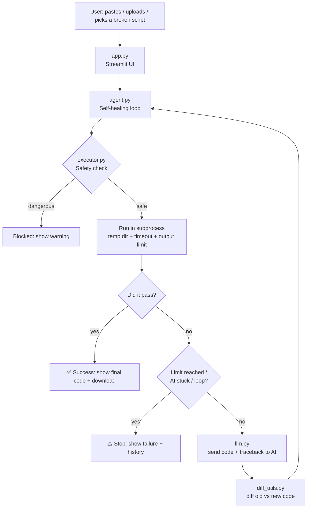

# 🩹 Self-Healing Script Agent

An AI agent that **fixes broken Python scripts by itself**.
You give it a broken script → it runs it → reads the error → asks an AI for a fix →
applies the fix → runs it again → repeats until the script works (or a safety limit is hit).

> **Project for:** Version Control Systems (VCS) – Midterm
> **Live demo:** <https://self-healing-agent-vartika.streamlit.app>

## 👥 Team

| Member | Role |
|---|---|
| **Prachi** | Ideation, project coordination, GitHub repository, documentation |
| **Vartika** | Built the agent (core loop, sandbox, AI integration, Streamlit app) |
| **Anushka** | _[add role, e.g. testing / demo scripts]_ |
| **Chhavi** | _[add role, e.g. presentation / documentation]_ |

---

## ✨ Features

- **Self-healing loop** – run → read traceback → AI fix → re-run, up to 5 attempts
- **Live view of every attempt** – code version, error, AI's explanation
- **Colour-coded diff** between versions (green = added, red = removed), like `git diff`
- **Fix history log** – a table of every attempt, its result and what changed
- **Healing efficiency meter** – how quickly the script was healed
- **Safe sandbox** – separate process, temp folder, 10-second timeout, output limit
- **Dangerous code blocked** – `os.system`, `shutil.rmtree`, `subprocess`, network modules, `eval/exec`
- **Loop guards** – stops if the AI repeats itself or goes back to an older version
- **Missing imports** – detects typos (`maths` → `math`) and suggests `pip install` for real packages (never auto-installs)
- **Download** the fixed script
- **8 ready-made broken demo scripts** + upload or paste your own
- **24 unit tests** with pytest (no API key needed – they use a fake AI)

## 🧠 How it works (architecture)



| File | Job |
|---|---|
| `app.py` | Web interface (Streamlit): input, live attempts, final result |
| `agent.py` | The loop + guards (max attempts, no-change check, cycle check) |
| `executor.py` | Sandbox: safety check (AST), subprocess, timeout, temp dir, output limit, error parsing |
| `llm.py` | Prompt design + calls to Gemini or Groq; parses the AI's reply |
| `diff_utils.py` | Diff and change statistics between code versions |
| `demo_scripts/` | Broken scripts for the live demo |
| `tests/` | pytest unit tests |

## 🚀 Setup (run on your own computer)

1. Install **Python 3.11+** and **Git**.
2. Clone the repo and enter the folder:
   ```bash
   git clone https://github.com/vartika629/self-healing-agent.git
   cd self-healing-agent
   ```
3. Install the libraries:
   ```bash
   pip install -r requirements.txt
   ```
4. Get a **free** Gemini API key at <https://aistudio.google.com/apikey>.
5. Copy `.env.example` to `.env` and paste your key into `GEMINI_API_KEY=`.
6. Run the app:
   ```bash
   streamlit run app.py
   ```
7. Run the tests:
   ```bash
   pytest
   ```

Want to use Groq instead? Set `LLM_PROVIDER=groq` and `GROQ_API_KEY=...` in `.env`.

## 🧪 Demo scripts

| # | Bug | What the agent should do |
|---|---|---|
| 1 | NameError (`mesage` typo) | Fix the variable name |
| 2 | ZeroDivisionError (empty list) | Handle the empty case |
| 3 | IndexError (loop too long) | Fix the range |
| 4 | Wrong import (`maths`) | Change to `math` |
| 5 | Infinite loop | Detect timeout, add the missing `count += 1` |
| 6 | Logic bug (failing `assert`) | Fix the formula (`* 10` → `* 100`), keep the assert |
| 7 | SyntaxError | Add the missing `:` and `)` |
| 8 | Dangerous code (`shutil.rmtree`) | **Blocked** – never run, never sent to the AI |

## 📸 Screenshots

_Add screenshots to a `screenshots/` folder and they will show up below:_
- `screenshots/home.png` – main screen
- `screenshots/attempts.png` – live attempts with diff
- `screenshots/success.png` – final result

## ⚠️ Limitations

- The sandbox is **best-effort**, not real security. The static check can be fooled
  (e.g. code built from strings). A production version should use Docker or a VM.
- The AI can be wrong: it may "fix" the error but change the meaning of the program.
  The agent only knows the script *runs without errors*, not that it is *correct*
  (asserts help with this).
- Scripts that need user input (`input()`), files, internet or extra packages will not run.
- Needs internet and an API key; free tiers have rate limits.
- Long scripts may hit the AI's input limit.

## 🔭 Future scope

- Run scripts inside Docker containers for real isolation
- Let the user add their own test cases, so "fixed" means "passes the tests"
- Support more languages (JavaScript, Java)
- Automatically open a GitHub Pull Request with the fix
- Compare several AI models and pick the best fix

## 📚 References / Acknowledgements

- [Streamlit](https://streamlit.io) – web UI
- [Google Gemini API](https://ai.google.dev) and [Groq API](https://console.groq.com/docs) – AI models
- Python standard library: `subprocess`, `ast`, `difflib`, `tempfile`
- [pytest](https://docs.pytest.org) – testing
- Code written with help from Claude (Anthropic) as an AI coding assistant
